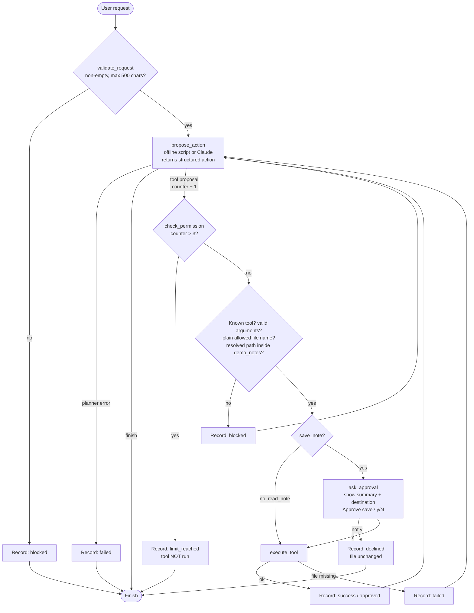

# Workflow

Each user request runs once through this LangGraph graph (`build_graph` in `app.py`).
The tool-call counter starts at 0 for every request.

## Steps in plain English

1. **validate_request:** rejects empty or very long requests before any AI call.
2. **propose_action:** asks the planner for **one** next step as structured data:
   `{tool, path, content, reason}`. Offline mode uses a fixed script. Live mode uses Claude with structured outputs.
   Every proposal adds 1 to the counter.
3. **check_permission:**
   - stops the request if this is the 4th proposal (`limit_reached`);
   - validates the shape with Pydantic (unknown fields, wrong types and missing values are blocked);
   - allows only `read_note` and `save_note`, and only their listed files;
   - requires a plain file name (no `/`, `\`, `:` or `..`), resolves the real path (following links), and requires that it stays inside `demo_notes`.
   A blocked proposal is logged and reported back to the planner, and it still uses up one of the 3 calls.
4. **ask_approval:** for `save_note` only. It prints the exact summary and destination, warns if the file will be replaced,
   and continues only if the user types `y`. Note contents can't answer this prompt. Only the keyboard can.
5. **execute_tool:** runs the harmless file operation and records the outcome.
6. The loop returns to step 2 until the planner says `finish`, the user declines, or the limit is hit.
   LangGraph's `recursion_limit=30` is an extra backstop against an endless graph.

## Who decides what

| Decision | Made by |
|---|---|
| Which step to try next | Planner (AI or script) |
| Whether the tool and file are allowed | Python (`check_action`) |
| Whether a save happens | The human, by typing `y` |
| How many steps are allowed | Python (`MAX_TOOL_CALLS = 3`) |
| What gets recorded | Python (`write_audit`), never note contents or keys |
